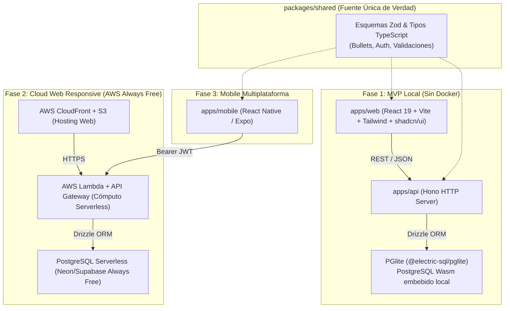

# Mike ZenLog — Minimalist Bullet Journal (Agenda 2026)

Aplicación de organización personal minimalista basada en la filosofía **Bullet Journal (Daily Log)**, diseñada bajo arquitectura **Monorepo Full-Stack TypeScript** y preparada para despliegue Cloud Zero-Cost (**AWS Always Free** + **PostgreSQL Serverless**).

---

## Arquitectura Evolutiva por Fases



---

## Estructura del Repositorio

```text
mike-zenlog/
├── apps/
│   ├── api/                        # Backend REST/RPC (Hono + Drizzle ORM + PGlite / PostgreSQL)
│   ├── web/                        # Frontend Web Minimalista (React + Vite + Tailwind + shadcn/ui)
│   └── mobile/                     # (Fase 3) App Mobile Multiplataforma (React Native / Expo)
├── packages/
│   └── shared/                     # Esquemas Zod, contratos de API y tipos compartidos
├── docs/
│   ├── KANBAN.md                   # Tablero Kanban activo de seguimiento de Issues
│   ├── requirements/SRS.md         # Especificación de Requisitos de Software
│   ├── architecture/adr/           # Architecture Decision Records (ADR-001 a ADR-006)
│   ├── backlog/USER_STORIES.md     # Épicas, Historias, Issues y Criterios Gherkin
│   ├── workflow/GITFLOW.md         # Guía de flujo GitFlow y convenciones de ramas/commits
│   └── learning/DEV_NOTEBOOK.md    # Cuaderno de Desarrollo y notas de estudio
├── .github/                        # Templates de Issues, PRs y Workflows de CI (GitHub Actions)
├── .env.example                    # Plantilla de variables de entorno segura para versionar
├── CONTRIBUTING.md                 # Guía rápida de contribución del equipo
└── package.json                    # Configuración raíz de npm workspaces
```

---

## Inicio Rápido (Entorno Local)

1. **Clonar el repositorio**:
   ```powershell
   git clone https://github.com/mikefink22/mike-zenlog.git
   cd mike-zenlog
   ```

2. **Copiar variables de entorno de ejemplo**:
   ```powershell
   Copy-Item .env.example .env
   ```

3. **Instalar dependencias del monorepo**:
   ```powershell
   npm install
   ```

4. **Ejecutar tests automatizados y verificación de tipos**:
   ```powershell
   npm run typecheck
   npm test
   ```

---

## Documentación de Ingeniería

- 📋 **Tablero Kanban**: [docs/KANBAN.md](./docs/KANBAN.md)
- 📐 **Requisitos de Software (SRS)**: [docs/requirements/SRS.md](./docs/requirements/SRS.md)
- 🎯 **Historias de Usuario y Criterios Gherkin**: [docs/backlog/USER_STORIES.md](./docs/backlog/USER_STORIES.md)
- 🌿 **Flujo de Trabajo GitFlow**: [docs/workflow/GITFLOW.md](./docs/workflow/GITFLOW.md)
- 🏛️ **Decisiones de Arquitectura (ADRs)**: [docs/architecture/adr/](./docs/architecture/adr/)
- 📓 **Cuaderno de Desarrollo**: [docs/learning/DEV_NOTEBOOK.md](./docs/learning/DEV_NOTEBOOK.md)
