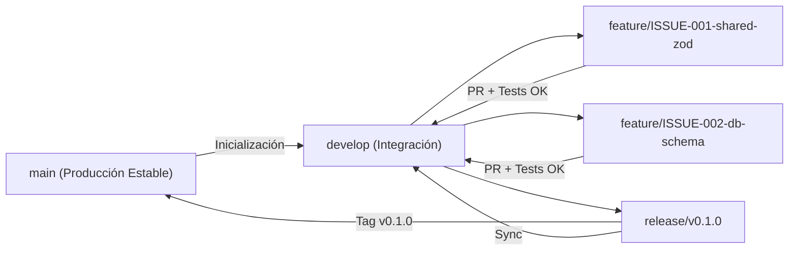

# Metodología GitFlow y Flujo de Trabajo del Equipo

En este proyecto trabajamos simulando un equipo de ingeniería de software profesional. No utilizamos una Wiki externa para evitar documentación huérfana; todo el flujo vive aquí bajo el paradigma **Docs-as-Code**.

---

## 1. Mapa de Ramas (GitFlow)



### Roles de cada rama:
1. **`main`**:
   - Contiene únicamente versiones listas para usar o desplegar (`v0.1.0`, `v0.2.0`, `v1.0.0`).
   - **Rama protegida**: Nunca se hacen commits directos aquí (después del commit fundacional).
2. **`develop`**:
   - Rama principal de integración donde convergen todas las funcionalidades terminadas y probadas.
   - **Rama protegida**: Nunca se programa directamente sobre `develop`.
3. **`feature/ISSUE-XXX-<slug>`**:
   - Nace siempre desde `develop`: `git checkout develop && git checkout -b feature/ISSUE-001-monorepo-setup`.
   - Resuelve un único Issue del tablero [KANBAN.md](../KANBAN.md).
   - Al finalizar y pasar todos los tests (`npm test`), se fusiona hacia `develop` mediante Pull Request (o `git merge --no-ff` validado).
4. **`fix/ISSUE-XXX-<slug>`**:
   - Nace desde `develop` para corregir un defecto detectado durante la integración.
5. **`release/vX.Y.Z`**:
   - Nace desde `develop` cuando completamos un Hito (ej. Fase 1 MVP Local).
   - Solo se permiten ajustes finales de documentación, bump de versión y correcciones menores antes de fusionar a `main` y etiquetar (`git tag v0.1.0`).
6. **`hotfix/vX.Y.Z-<slug>`**:
   - Nace desde `main` solo si se descubre un error crítico en producción que no puede esperar al próximo release. Se fusiona tanto a `main` como a `develop`.

---

## 2. Convención de Commits (Conventional Commits)

Todos los mensajes de commit deben seguir el formato:

```text
<tipo>(<alcance>): <descripción breve en imperativo/minúsculas> (#ISSUE-XXX)
```

### Ejemplos válidos:
- `chore(repo): initialize gitflow structure and documentation` *(Commit fundacional)*
- `feat(shared): add bullet item zod schemas and unit tests (#ISSUE-001)`
- `feat(api): implement daily log CRUD endpoints with pglite (#ISSUE-004)`
- `test(api): add gherkin acceptance tests for task migration (#ISSUE-005)`
- `docs(notebook): explain zod type inference vs drf serializers (#ISSUE-001)`

---

## 3. Protección de Ramas (Local y en GitHub)

### 3.1 En el Entorno Local (Automático)
Contamos con el hook `.agents/hooks.json` -> `.agents/scripts/security-gitflow-guard.mjs` que:
- Impide al agente ejecutar `git commit` si la rama actual es `main` o `develop` (una vez creado el commit fundacional).
- Impide `git push --force`.
- Impide leer o modificar archivos `.env` reales.

### 3.2 En GitHub (Cuando conectemos el repositorio remoto con `gh`)
Cuando subamos el repositorio a GitHub, configuraremos las reglas de protección con un solo comando de `gh api` o desde Settings -> Branches:
- Proteger `main` y `develop`.
- Requerir Pull Request antes de hacer merge.
- Requerir que el check de GitHub Actions (`CI - Test & Typecheck`) esté en estado **Passed (Verde)**.
